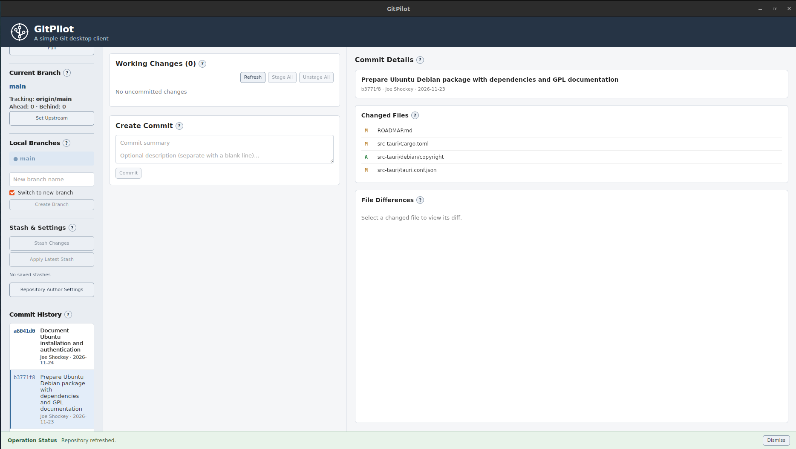

# GitPilot

**A simple, cross-platform desktop interface for Git.**

GitPilot is a lightweight Git client focused on everyday version control, a clear interface, and optional contextual help rather than subscriptions or unnecessary complexity.

Created by Joe Shockey ([Opteryx](https://github.com/opteryx)).

## Features

- Open, initialize, and clone Git repositories.
- View commit history, changed files, and colorized file differences; identify binary changes.
- Stage and unstage files, create commits, and configure a repository-specific commit author.
- Create, switch, delete, and merge branches; resolve merge conflicts.
- Configure remotes and upstream branches; create GitHub repositories and publish branches.
- Fetch, push, and pull using fast-forward-only (default), merge, or rebase strategies, with rebase conflict recovery.
- Stash and restore changes, discard unstaged tracked-file changes with confirmation, and refresh repository information.
- Use optional help popups and tooltips for Git terminology and controls.

## Installation and development

GitPilot 0.1.0 has been built and tested on **Ubuntu 22.04 LTS (64-bit AMD64)**. The first public Ubuntu installer is being prepared.

Windows and macOS packages are planned for the future but have not yet been tested.

### Install on Ubuntu

Once the first release is published, download `GitPilot_0.1.0_amd64.deb` from the [GitPilot Releases page](https://github.com/opteryx/gitpilot/releases).

Open a terminal in the directory containing the downloaded file and run:

```bash
sudo apt install ./GitPilot_0.1.0_amd64.deb
```

APT will install the required dependencies, including Git, GTK, and WebKitGTK, if they are not already installed.

After installation, launch **GitPilot** from Ubuntu's application menu.

### Git authentication and GitHub integration

GitPilot uses your existing Git authentication configuration:

- **SSH:** Uses your configured SSH keys and SSH agent.
- **HTTPS:** Uses your configured Git credential helper.
- **GitHub CLI (`gh`):** Required only for GitPilot's **Create GitHub Repository** feature. It is not required for ordinary Git operations.

GitPilot does not require a subscription.

### Development prerequisites

To build and run GitPilot from source, install:

- Git
- Node.js and npm
- Rust and Cargo
- [Tauri 2 development dependencies](https://v2.tauri.app/start/prerequisites/) for your operating system

### Run from source

```bash
git clone https://github.com/opteryx/gitpilot.git
cd gitpilot
npm install
npm run tauri dev
```

## Screenshots

## Screenshots



## Technologies

GitPilot uses **Tauri 2**, **React**, **Vite**, **JavaScript**, **Rust**, and the installed **Git** executable.

## Roadmap

GitPilot 0.1.0 has been successfully built, installed, and tested on Ubuntu 22.04 LTS. The current priority is completing release documentation, licensing checks, and preparation for the first public Ubuntu release. Windows and macOS support remains a future goal.

See [ROADMAP.md](ROADMAP.md) for completed work, remaining release checks, and deferred enhancements.

## Contributing

GitPilot is currently a personal development project. Contribution guidelines may be added later.

## License

Copyright © 2026 Joe Shockey.

GitPilot is free software licensed under the **GNU General Public License, version 3 only** (`GPL-3.0-only`). You may use, modify, and redistribute GitPilot under the terms of that license.

See [LICENSE](LICENSE) for the full license text.
